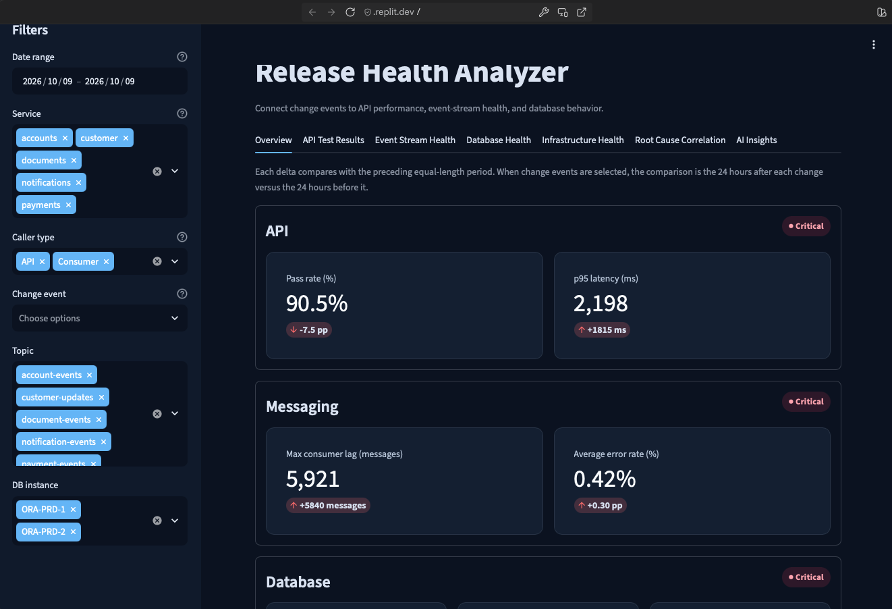
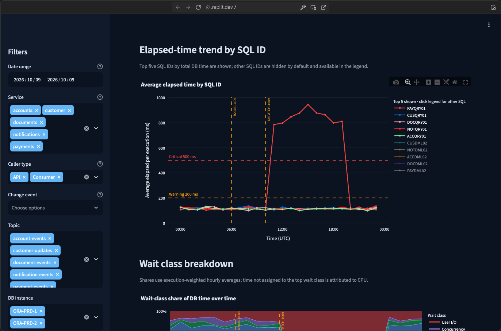
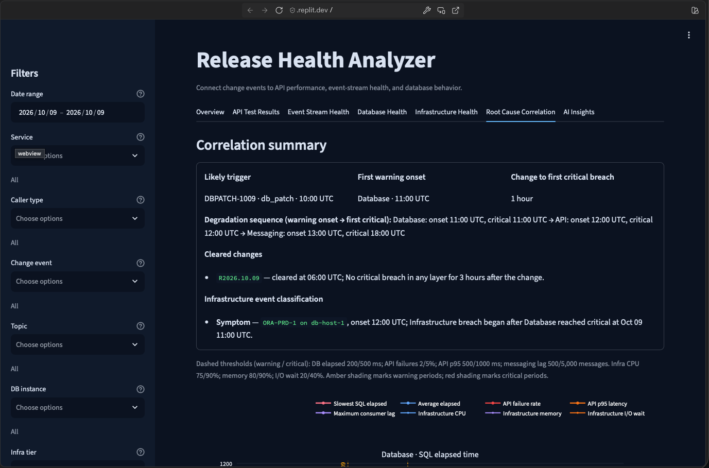
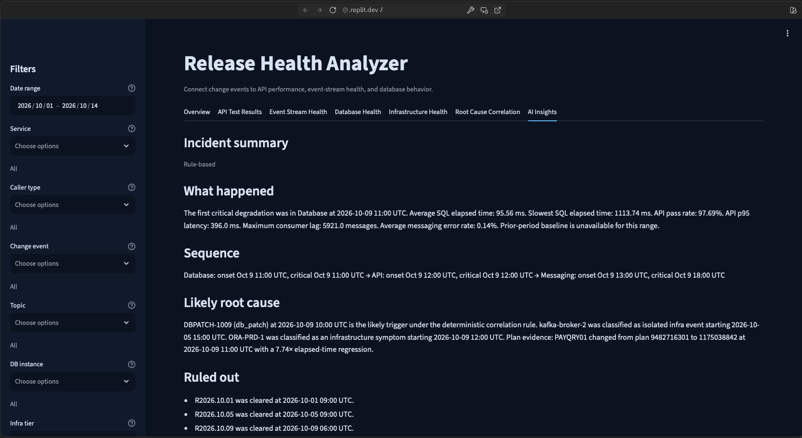

# Release Health Analyzer

A Streamlit dashboard that correlates application, messaging, database, and infrastructure health with change events.

> **Synthetic data only:** all included CSVs are generated for this demo; no real, proprietary, or employer data is used.

## The problem

After a release, database patch, or configuration change, teams must determine whether it caused a regression and where the impact appeared. API failures, consumer lag, database waits, and infrastructure alerts usually live in separate tools. Symptoms can appear downstream from the actual cause, making manual correlation slow. This dashboard aligns the layers and change events to answer: **“Did this change break anything, where, and why?”**

## Features

- **Overview** — Layer health indicators, KPIs vs. baseline, and time-series trends.
- **API Test Results** — Pass rates by service and endpoint, latency percentiles, failure reasons, and release comparisons.
- **Event Stream Health** — Partition lag heatmap, throughput, error rates, and the most lagging consumer groups.
- **Database Health** — DB time by connection user and caller type, top SQL, elapsed-time trends, wait classes, and plan regressions.
- **Infrastructure Health** — CPU, memory, and I/O wait, restart/OOM events, and unhealthy components.
- **Root Cause Correlation** — Time-aligned layers, thresholds, change markers, degradation order, and cleared, symptom, or isolated classifications.
- **AI Insights** — A deterministic incident summary plus an optional, on-demand LLM explanation of the filtered context.

## Demo scenario

**October 9 incident:** The `R2026.10.09` application release at **06:00 UTC** is cleared. At **10:00**, `DBPATCH-1009` is applied. At **11:00**, `PAYQRY01` changes execution plan and regresses about **7.7×**. Payments API degradation follows at **12:00**, then payment-events lag starts building at **13:00**. The `db-host-1` I/O-wait increase follows the plan change and is classified as an infrastructure symptom, not the trigger.

**October 5 red herring:** `kafka-broker-2` experiences memory pressure and restarts once. Its brief lag impact is classified as an isolated infrastructure event, with no corresponding API or database degradation.

## Architecture

```text
data/generate_data.py
        │ writes fixed-seed CSVs
        ▼
data/*.csv → data/loader.py (@st.cache_data)
        ▼
analysis/ (metrics, shared thresholds, correlation, AI context)
        ▼
views/ (one Streamlit/Plotly view per tab)
        ▼
app.py (filters, tabs, Streamlit entry point)
```

```text
.
├── app.py
├── analysis/          # Metrics, thresholds, filtering, root-cause and AI context logic
├── data/              # CSV generator, cached loader, and generated datasets
├── docs/screenshots/  # Screenshot assets
├── views/             # Tab views and shared chart helpers
├── PROMPTS.md         # Spec-driven build prompts and outcomes
├── SPEC.md            # Product specification
└── pyproject.toml     # Python dependencies
```

## Datasets

Row counts exclude the CSV header.

| File | Rows | Description |
|---|---:|---|
| `api_test_runs.csv` | 66,528 | Individual API test outcomes, latency, release tags, and failure reasons. |
| `kafka_metrics.csv` | 10,080 | Hourly topic/partition lag, throughput, and error rates. |
| `db_metrics.csv` | 13,440 | Hourly SQL performance, connection users, waits, and execution plans. |
| `infra_metrics.csv` | 4,032 | Hourly app, Kafka, and database resource and health metrics. |
| `change_events.csv` | 4 | Application releases and the database patch used for correlation. |

Regenerate all five files with `python data/generate_data.py`. The generator uses fixed seeds (`179166` for core datasets and `179167` for infrastructure) so the demo scenarios and row counts are reproducible.

## Run locally

Python 3.13 or newer is required.

```bash
pip install -r requirements.txt
python data/generate_data.py
streamlit run app.py
```

AI summaries are optional and require an `OPENAI_API_KEY` in the environment or Replit Secrets. Set `LLM_MODEL` to override the default model (`gpt-5.4-mini`). Never commit API keys.

## Design decisions

- **DB caller attribution uses connection users, not Oracle `MODULE`.** The `SVC_<SERVICE>_<API|CONSUMER>` account convention remains useful when `MODULE` is unset or generic.
- **Root-cause correlation is deterministic.** The LLM only explains the summarized result; it does not determine the trigger or breach order.
- **Thresholds are shared.** `analysis/thresholds.py` keeps health states and visual thresholds consistent across views.
- **Onset and critical are distinct.** The sequence is ordered by each layer’s first warning onset and shows its first critical time separately.
- **Average and worst SQL are both shown.** A layer-wide average can hide a single query with a severe elapsed-time regression.

## Built with AI (vibe coding)

Replit Agent helped build the code from [spec-driven prompts](SPEC.md), with prompt history in [PROMPTS.md](PROMPTS.md). A human verified the data scenarios, app behavior, and visual output at each step.

## Production path

- Ingest real API test results from Newman, Kafka metrics from Prometheus, Oracle AWR/ASH data, and Kubernetes metrics.
- Add alerting and authentication.
- Add automated tests to CI.
- Use RAG over runbooks and past incidents to ground AI Insights in operational guidance.

## Screenshots

Placeholder paths are ready for screenshots:








